<div align="center">


# Dynamic Island для Windows

**Живая «пилюля» над экраном, как на iPhone: музыка, уведомления, таймеры, календарь, погода и полка для файлов.**

[](https://github.com/sergey1029/dynamic-island-windows/releases/latest)


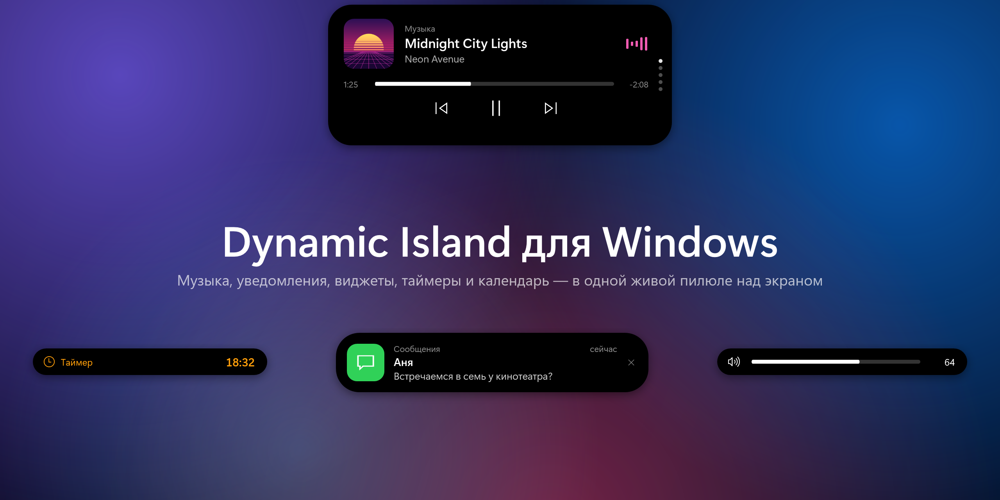

</div>

## Возможности

### 🎵 Музыка

Работает с любым плеером, который поддерживает системные медиаконтролы Windows: Spotify, Яндекс Музыка, YouTube и другие сайты в браузере, VLC, «Медиаплеер». В компактном режиме видны обложка и эквалайзер в цвете обложки. При наведении открывается полный плеер с перемоткой.

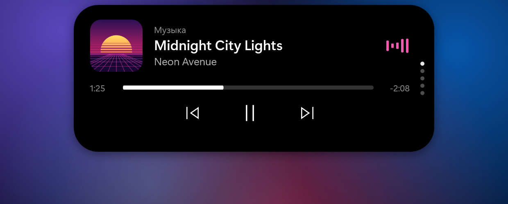

### 🔔 Уведомления

Уведомления из приложений появляются прямо на острове. Клик открывает приложение-источник, крестик закрывает уведомление.

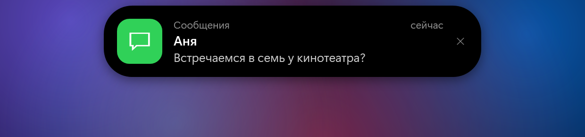

### ✨ Живые состояния

Смена трека, громкость, подключение зарядки, идущий таймер, напоминания о встречах: остров меняет форму под каждое событие и плавно возвращается обратно.

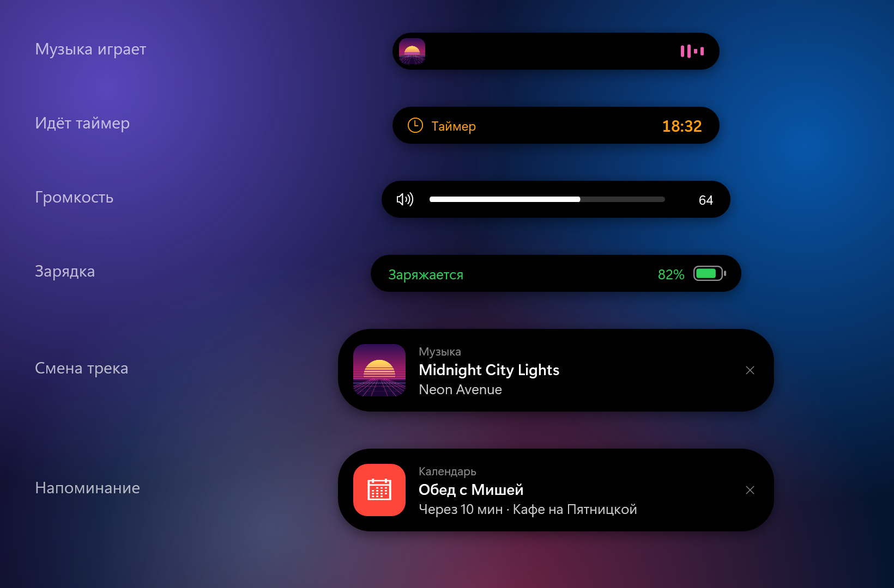

### 🕐 Главная и стили часов

Часы, погода (Open-Meteo, без ключей), питание, процессор и память. Пять стилей часов на выбор: Классика, Жирный, Стрелки, Стопка и Неон.

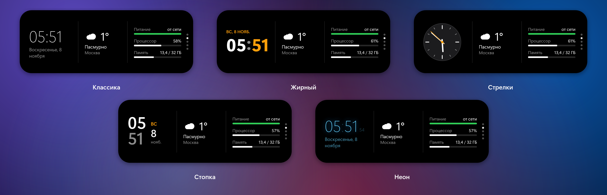

### 📅 Календарь

Ближайшие события из Google, Яндекс, Outlook, iCloud или любого iCal-календаря. У каждого календаря свой цвет, а за несколько минут до начала события приходит напоминание.

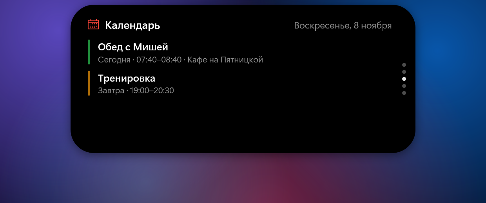

### ⏱ Таймер и секундомер

Таймер с быстрыми пресетами и секундомер. Пока они идут, на компактном острове видно время, а по окончании таймера звучит сигнал.

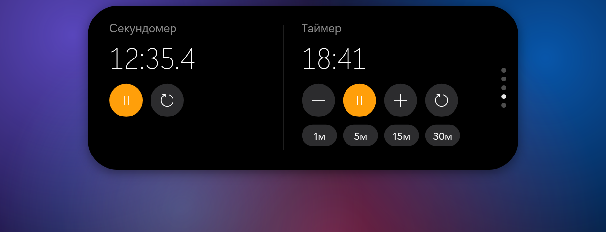

### 📂 Полка

Перетащите файлы на остров, чтобы положить их на полку, а потом вытащите в любую папку, письмо или мессенджер. Двойной клик открывает файл.

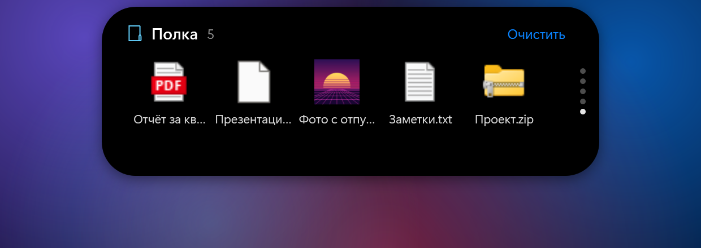

### 🫥 Автоскрытие

Когда открыто окно, остров сплющивается и прячется в верхний край экрана. Вернуть его можно двумя способами:

- **навести мышь в центр верхнего края экрана**: работает на рабочем столе и с обычными окнами;
- **горячая клавиша** `Ctrl + Alt + I`: короткое нажатие открывает остров, а если зажать, остров виден, пока держите клавиши.

Уведомления и индикаторы показываются и на скрытом острове. В полноэкранных играх и видео это по желанию.

## ⚙️ Настройки

Отдельное окно в стиле Windows 11, все изменения применяются сразу. Открыть его можно правым кликом по острову → «Настройки…», ярлыком «Настройки Dynamic Island» в меню «Пуск» или повторным запуском программы.

| | |
|:-:|:-:|
| 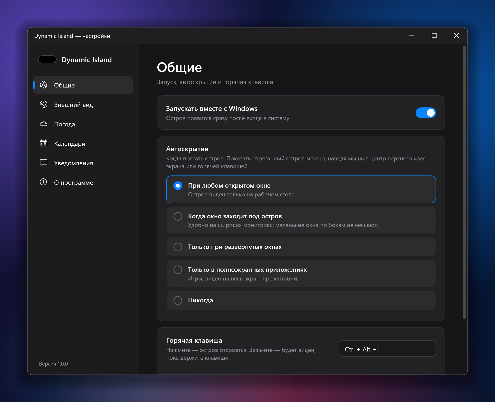 | 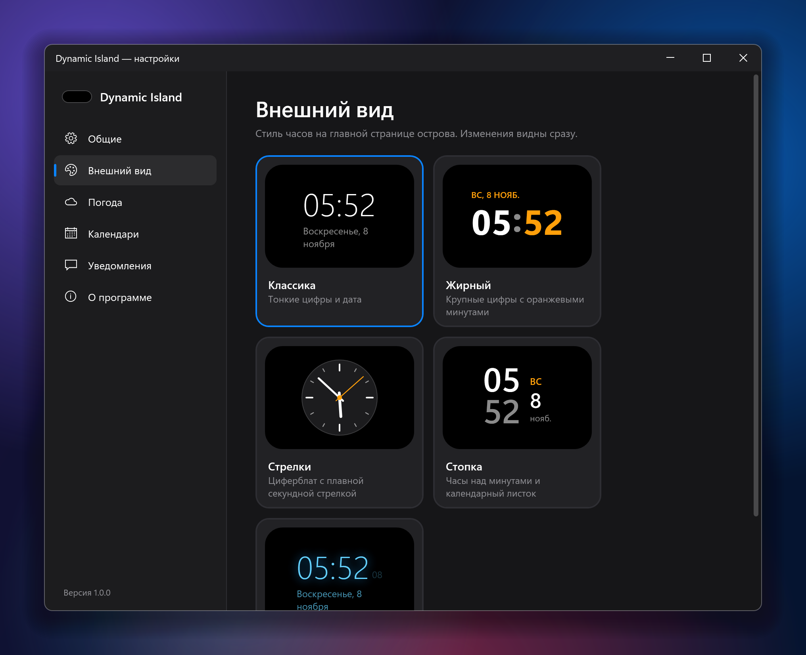 |
| **Общие**: автозапуск, режим автоскрытия, горячая клавиша | **Внешний вид**: стили часов с живыми превью |
| 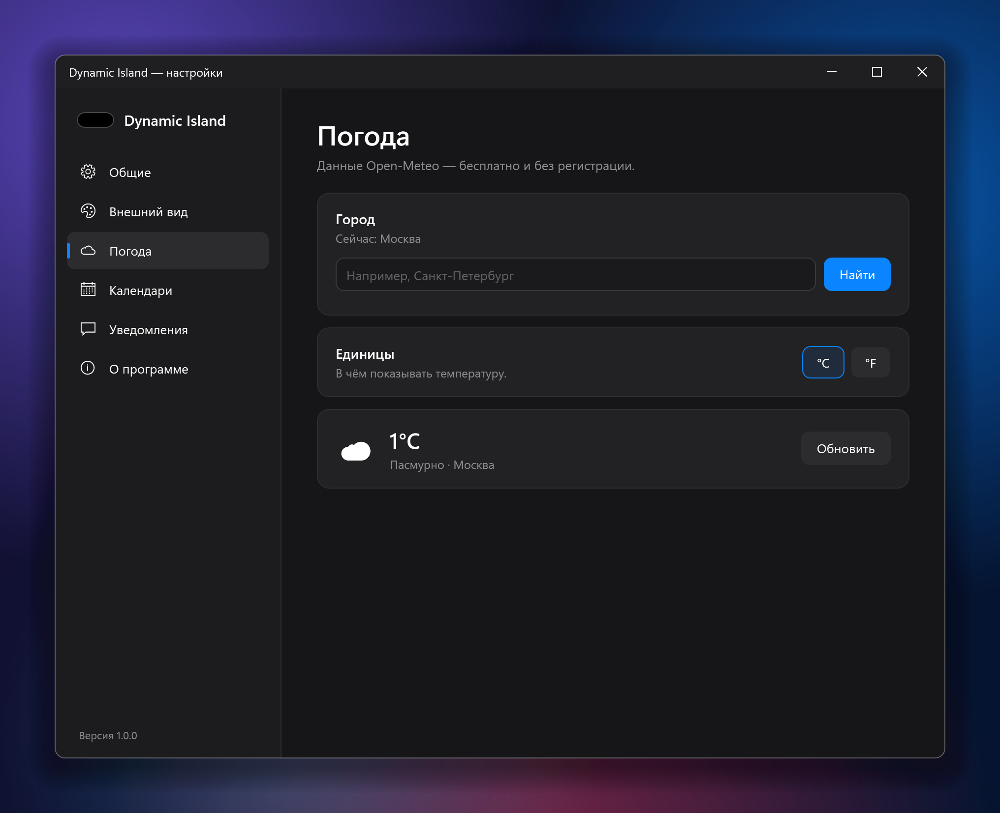 | 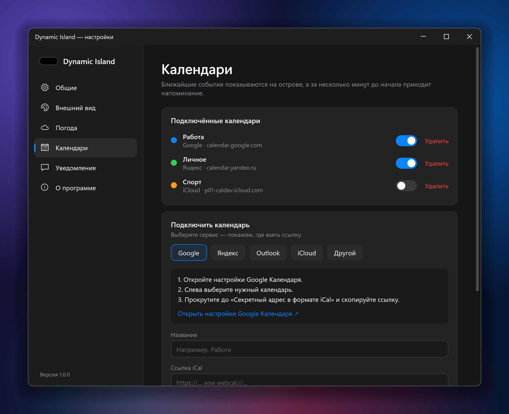 |
| **Погода**: поиск города, °C или °F | **Календари**: пошаговое подключение сервисов |

<div align="center">
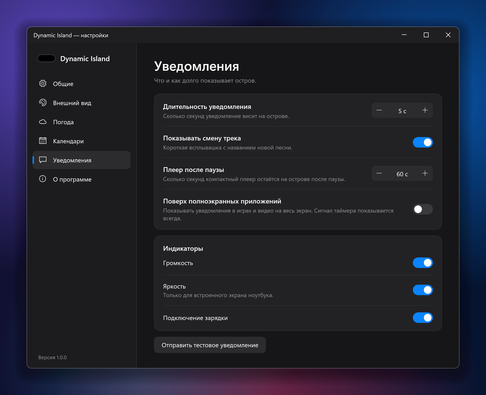
</div>

## 📥 Установка

1. Скачайте `DynamicIsland-Setup-x.y.z.exe` со страницы [**последнего релиза**](https://github.com/sergey1029/dynamic-island-windows/releases/latest).
2. Запустите его. Права администратора не нужны, .NET устанавливать тоже не нужно.
3. По желанию отметьте «Запускать вместе с Windows».

Если не хочется ничего устанавливать, рядом лежит портативная версия `DynamicIsland-Portable-x.y.z.exe`: это один файл, который можно просто запустить.

> **SmartScreen.** Файлы не подписаны сертификатом, поэтому Windows может показать предупреждение «Неизвестный издатель». Нажмите «Подробнее» → «Выполнить в любом случае».

**Требования:** Windows 10 версии 2004 или новее либо Windows 11, x64.

## 🖱 Управление

| Действие | Что происходит |
|---|---|
| Наведение на остров | Остров раскрывается |
| Колесо мыши | Страницы: плеер → главная → календарь → таймер → полка |
| Клик по уведомлению | Открыть приложение |
| Перетаскивание файла на остров | Положить файл на полку |
| Мышь в центр верхнего края / `Ctrl + Alt + I` | Показать спрятанный остров |
| Правый клик | Меню: настройки, автозапуск, выход |

## 📅 Где взять ссылку на календарь

В настройках есть пошаговые инструкции и кнопка, которая открывает нужную страницу. Коротко:

- **Google**: Настройки → нужный календарь → «Секретный адрес в формате iCal».
- **Яндекс**: календарь в списке слева → ⚙ → «Экспорт» → ссылка iCal.
- **Outlook**: Параметры → Календарь → Общие календари → «Опубликовать календарь» → ICS.
- **iCloud**: значок общего доступа у календаря → «Публичный календарь».

## ⚠️ Ограничения Windows

- Родное окно громкости Windows 11 спрятать нельзя, поэтому видны оба индикатора.
- Ответить на сообщение с острова нельзя: Windows не даёт сторонним программам нажимать кнопки в чужих уведомлениях. Поэтому клик по уведомлению открывает приложение.
- Индикатор яркости работает только для встроенного экрана ноутбука.
- Если уведомления не появляются, включите доступ: Параметры → Конфиденциальность и защита → Уведомления.

## 🛠 Сборка из исходников

Нужен [.NET 9 SDK](https://dotnet.microsoft.com/download/dotnet/9.0).

```powershell
git clone https://github.com/sergey1029/dynamic-island-windows.git
cd dynamic-island-windows
dotnet run -c Release
```

Сборка установщика (нужен [Inno Setup 6](https://jrsoftware.org/isinfo.php)):

```powershell
dotnet publish -c Release -r win-x64 --self-contained -p:PublishSingleFile=true -p:IncludeNativeLibrariesForSelfExtract=true -p:EnableCompressionInSingleFile=true -o publish
iscc /DMyAppVersion=1.0.0 installer\DynamicIsland.iss   # → dist\DynamicIsland-Setup-1.0.0.exe
```

Релизы собираются автоматически в GitHub Actions при пуше тега `v*`.

### Скриншоты и графика

Скриншоты в этом README сделаны самой программой на демо-данных:

```powershell
DynamicIsland.exe --screenshots docs\screenshots   # скриншоты острова и окна настроек
DynamicIsland.exe --assets Assets                  # иконка и картинки для установщика
```

### Свой стиль часов

Реализуйте интерфейс `IClockStyle` в [`Core/ClockStyles.cs`](Core/ClockStyles.cs) (поля `Id`, `Name`, `Description` и метод `Create`) и добавьте экземпляр в `ClockStyles.All`. Стиль сам появится в настройках.

### Устройство проекта

```
Core/            настройки, стили часов, WinAPI, горячая клавиша, полка
Services/        музыка, уведомления, громкость, яркость, погода, календарь, таймеры
MainWindow.*.cs  остров: состояния и анимации, плеер, уведомления, автоскрытие, страницы
SettingsWindow   окно настроек
installer/       скрипт Inno Setup
```

Настройки и лог хранятся в `%AppData%\DynamicIsland\`.
