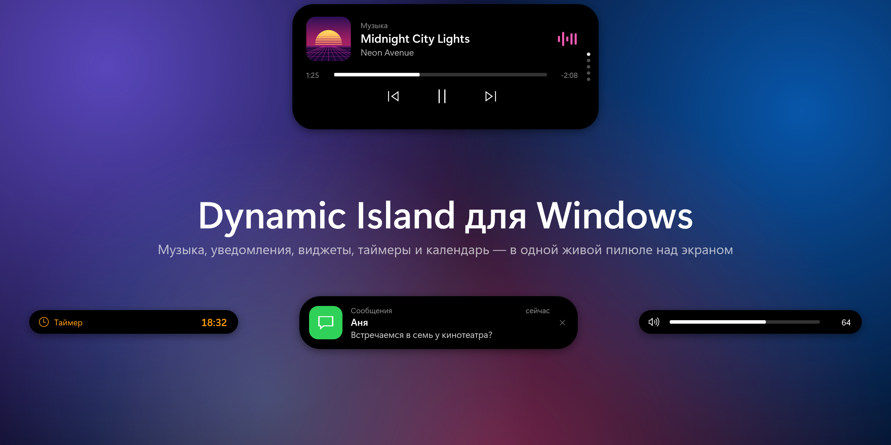

## Что нового в 1.0.1

### ⏱ Плавный секундомер
- Цифры секундомера больше не прыгают: пока он идёт, время обновляется каждый кадр, а не четыре раза в секунду.
- Добавлены сотые доли секунды (`1:23,45`), как в секундомере iPhone. Плавно идёт и компактная пилюля.
- Когда секундомер остановлен, покадровое обновление отключается и не нагружает систему.

### 🔔 Уведомления из Telegram и других программ
- Остров видит только системные уведомления Windows, а Telegram по умолчанию рисует собственные всплывающие окна, поэтому его сообщения не появлялись. В настройках (раздел «Уведомления») и в README появилась подсказка, как это исправить: в Telegram откройте **Настройки → Уведомления и звуки** и включите **«Использовать уведомления Windows»**.

## Установка

- **`DynamicIsland-Setup-1.0.1.exe`**: установщик. Ставится без прав администратора, обновляет предыдущую версию поверх, настройки сохраняются. Рекомендуется.
- **`DynamicIsland-Portable-1.0.1.exe`**: один файл без установки, просто запустите.

.NET устанавливать не нужно, всё уже внутри. Требуется Windows 10 (2004) или Windows 11, x64.

> Windows SmartScreen может предупредить о неизвестном издателе, потому что файл не подписан сертификатом. Нажмите «Подробнее» → «Выполнить в любом случае».
